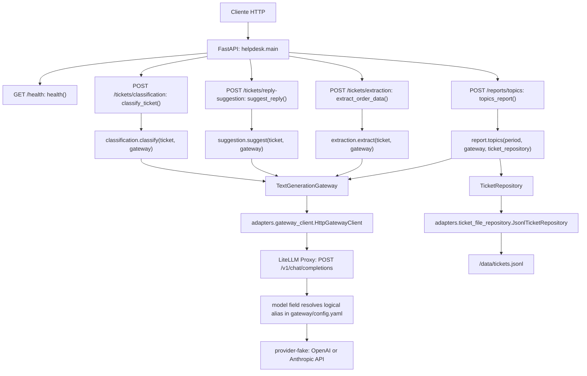

# Fluxo da aplicação helpdesk — v2 desacoplada

## Fluxo geral

## Fluxos por endpoint

- **`GET /health`** → `main.health()` → retorna `{"status": "ok"}`.
- **`POST /tickets/classification`** → `main.classify_ticket()` → `classification.classify(ticket, gateway)` → `TextGenerationGateway.generate("ticket-classification", "classify", text)` → `HttpGatewayClient` → gateway resolve o modelo configurado → interpreta o JSON e valida categoria e prioridade → retorna `Classification`.
- **`POST /tickets/reply-suggestion`** → `main.suggest_reply()` → `suggestion.suggest(ticket, gateway)` → `generate("reply-suggestion", "suggest", text)` → adaptador HTTP → gateway → retorna `ReplySuggestion`.
- **`POST /tickets/extraction`** → `main.extract_order_data()` → `extraction.extract(ticket, gateway)` → `generate("order-extraction", "extract", text)` → adaptador HTTP → gateway → interpreta o JSON e valida o formato do pedido → retorna `OrderData`.
- **`POST /reports/topics`** → `main.topics_report()` → `report.topics(period, gateway, ticket_repository)` → valida o período → `TicketRepository.in_period()` → adaptador lê e filtra o JSONL → divide os tickets em lotes de 150 → chama `generate("ticket-topics", "topics", lote)` por lote → agrega e ordena tópicos → retorna `TopicsReport`.

## Fronteiras de dependência

- `ports.py` define os contratos `TextGenerationGateway` e `TicketRepository` como `Protocol`.
- Os módulos de feature dependem dos ports e dos schemas; não importam os SDKs nem os adaptadores concretos.
- `main.py` é o ponto de composição: instancia `HttpGatewayClient` e `JsonlTicketRepository` e os injeta nos casos de uso.
- `adapters/gateway_client.py` é o único componente em `app/` que chama o gateway.
- O LiteLLM Proxy escolhe provider e modelo físico pelo `model` lógico em `gateway/config.yaml`. `LITELLM_MASTER_KEY` autentica o app; as chaves de OpenAI e Anthropic ficam no ambiente do serviço `gateway`, fora do ambiente de `app`.
- `schemas.py` mantém os contratos HTTP e os tipos de dados da aplicação. O caso de uso do relatório mantém validação, loteamento e agregação; o adaptador de arquivo faz a leitura do JSONL.
