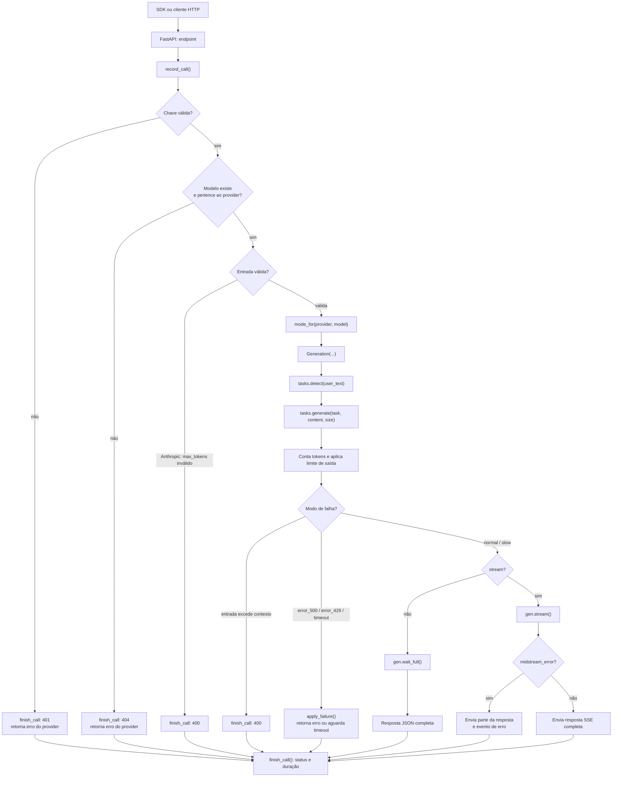
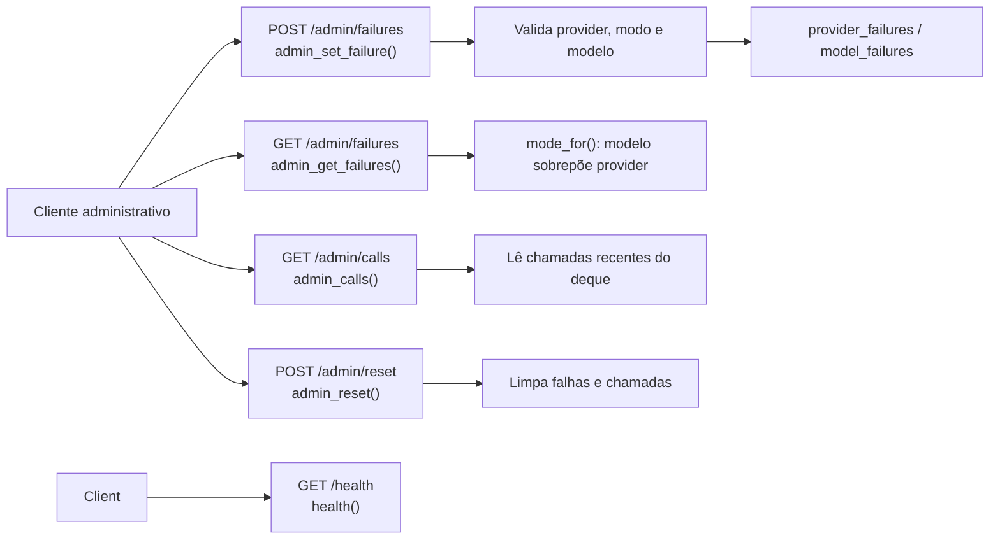

## Fluxo de chamadas do `provider-fake`

## Inferência por API

As duas rotas de inferência seguem a mesma sequência geral: registram a chamada, validam autenticação e modelo, montam uma `Generation`, aplicam o modo de falha, conferem o limite de contexto e respondem em JSON ou SSE.

- **OpenAI** — `POST /openai/v1/chat/completions` → `openai_chat()` → valida `Authorization: Bearer ...` e modelo → extrai mensagens e opções → `Generation(...)` → resposta Chat Completions ou stream SSE no formato OpenAI.
- **Anthropic** — `POST /anthropic/v1/messages` → `anthropic_messages()` → valida `x-api-key` (ou Bearer) e modelo → exige `max_tokens` → `Generation(...)` → resposta Messages ou stream SSE no formato Anthropic.

Em `Generation.__init__()`, o conteúdo da última mensagem do usuário passa por `tasks.detect()`, que separa a linha `TASK:` do texto. `tasks.generate()` então seleciona a função correspondente: `classify()`, `suggest()`, `topics()` ou `extract()` em `tasks.py`. Se a tarefa não for reconhecida, usa `fallback_text()`.

A resposta completa espera em `Generation.wait_full()`. No modo streaming, `Generation.stream()` emite fragmentos; os endpoints os convertem para os eventos SSE específicos de cada API. Ao concluir ou falhar durante o stream, `finish_call()` atualiza status e duração da chamada registrada.

## Administração e utilitários

As funções de suporte incluem `text_of()` (normaliza conteúdo), `count_tokens()` (estima tokens pelo número de caracteres), `truncate()` (limita a saída), `mode_for()` (determina a falha efetiva) e `openai_error()` / `anthropic_error()` (formatam erros conforme a API). O histórico de chamadas fica no `deque` em memória, limitado às últimas 5.000 entradas.

Arquivos principais: [main.py](/C:/src/mba/desafio-arquitetura-era-ia-1/provider-fake/app/main.py) concentra as rotas e respostas; [tasks.py](/C:/src/mba/desafio-arquitetura-era-ia-1/provider-fake/app/tasks.py) implementa as tarefas simuladas.
